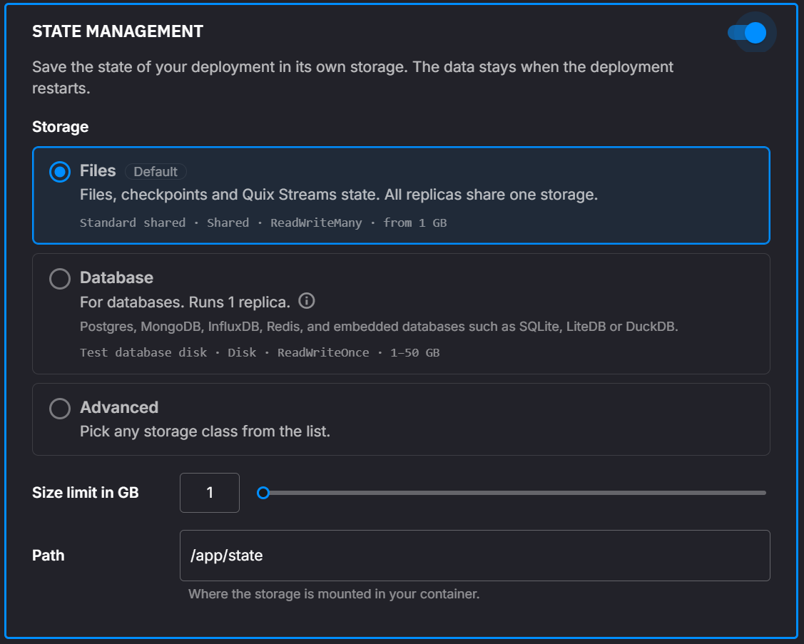
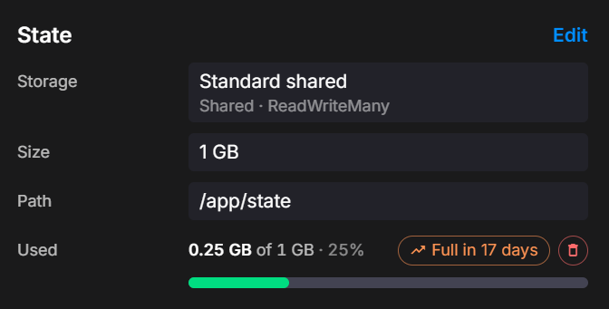
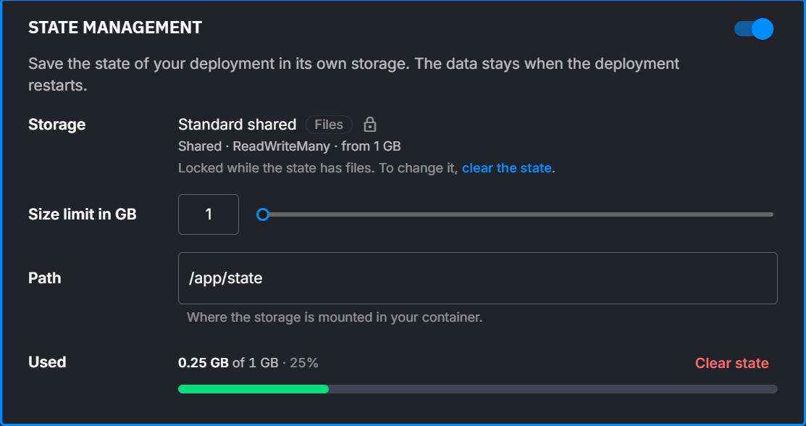
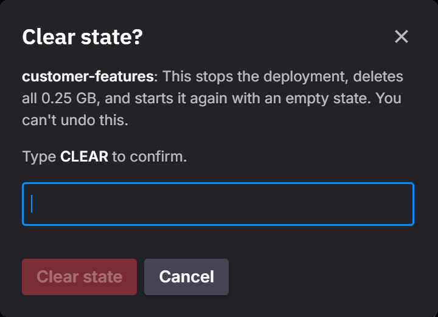

# State management

When you enable state for a deployment, Quix gives the deployment its own storage volume. Files your code writes there stay when the deployment restarts, so you can keep Quix Streams state, checkpoints, downloaded models and database files.

This page covers:

* [Enabling state](#enabling-state-management) and [choosing its storage](#choosing-the-storage): Files, Database or Advanced.
* [Setting state in `quix.yaml`](#setting-state-in-quixyaml) or [with the Portal API](#setting-state-with-the-portal-api).
* [Reading the State section](#reading-the-state-section) of a deployment: storage, size, path and usage.
* [Clearing the state](#clearing-the-state), which is also how you change the storage of a deployment whose state has files.
* [Using the state folder from your code](#reading-the-state-path-in-code) and [from Quix Streams](#using-state-from-quix-streams).

## Enabling state management

Enable state when your code relies on state, or expects files to persist across restarts:

1. In the deployment dialog, switch on **State Management**.
2. If the dialog shows **Storage**, choose **Files**, **Database** or **Advanced**. See [Choosing the storage](#choosing-the-storage). When the cluster lists no storage classes, the dialog shows no **Storage** choice and the cluster's default storage is used.
3. Set the **Size limit in GB**. On storage that doesn't enforce a size, the dialog shows **Limit not enforced** instead. See [Choosing the size](#choosing-the-size).

{width=80%}

A deployment has one state volume, and all its replicas mount that same volume. Other deployments don't mount it. By default the volume is mounted at `/app/state`. To mount it somewhere else, set `state.path` in [`quix.yaml`](#setting-a-custom-state-path), or change **Path** in the **Edit** dialog of an existing deployment. The mount path is available to your code in the [`Quix__Deployment__State__Path`](./quix-variables.md) environment variable.

### Choosing the storage

The storage options come from the cluster your environment runs on. Each option names a storage class, with its kind, its access mode and the sizes it allows.

| Storage | Use it for | Limits |
|---|---|---|
| **Files** | Files, checkpoints and Quix Streams state. It is marked **Default**. | Its storage class is always ReadWriteMany, so all replicas share one storage, and Jobs can use it. |
| **Database** | Databases such as Postgres, MongoDB, InfluxDB and Redis, and embedded databases such as SQLite, LiteDB or DuckDB. Most databases let only one process write their files. | You can't choose **Database** while **Replicas** is above 1. A Job can't use it when its storage class is ReadWriteOnce. |
| **Advanced** | Any storage class the cluster offers, when you need a specific one. Pick it in the **Storage class** dropdown. | A ReadWriteOnce class takes 1 replica only. A Job sees only ReadWriteMany classes. |

When a card or a class can't be used, the dialog shows why, for example `Not set up on this cluster. Ask your admin to add file storage.`

### Choosing the size

**Size limit in GB** runs from the storage class's minimum size, or 1 GB, up to your plan's state size limit, or the class's maximum when that is lower.

Some storage classes don't enforce a size for each deployment. On those, **Size** reads **Limit not enforced** instead of a slider, with the line `Uses the shared storage's free space. If it fills, writes fail for every deployment on it.` Quix doesn't count that state toward your plan's state size limits.

While the deployment keeps its state volume, its size can grow but not shrink. On a storage class that can't be resized, the size can't change at all. To start again at a smaller size, [clear the state](#clearing-the-state).

## Setting state in quix.yaml

You can set state in your `quix.yaml` file:

```yaml
deployments:
  - name: my-service
    application: my-app
    state:
      enabled: true
      size: 5
      storageClass: <storage-class-name> # Optional
      path: /data/state # Optional
```

`storageClass` is the name of a storage class the cluster offers:

* To find the name, choose **Advanced** in the deployment dialog and pick the class in **Storage class**: the line under the field starts with the class name. When you create a deployment with State on in the dialog, Quix also writes the class you chose to `state.storageClass` in `quix.yaml`.
* A class the cluster doesn't offer fails the sync with `The storage class '<name>' is not available on node group '<node group>'`.
* If you leave out `storageClass` for a new deployment, the cluster's default storage class is used. Leaving it out for an existing deployment keeps its current class.
* While the deployment keeps a state volume, you can't change `storageClass`. With State on, the sync fails with `To change the storage class, clear the state first.` [Clear the state](#clearing-the-state), then change it.
* On a storage class that doesn't enforce a size, Quix doesn't write `state.size` to `quix.yaml`, and ignores a `state.size` you add there.

### Setting a custom state path

By default, state is mounted at `/app/state`. Set `state.path` to mount it somewhere else. The path must:

* Start with `/`.
* Not contain `..`.
* Be at most 255 characters long.
* Use only letters, digits, `/`, `-`, `_` and `.`.

A custom path is useful when:

* Your application expects state at a specific location, for example `/var/lib/myapp`.
* You're deploying third-party containers with predefined data directories.
* You want to align with existing application conventions.

## Setting state with the Portal API

The [Portal API](../apis/portal-api/overview.md) takes the same values:

* `POST /deployments` and `PATCH /deployments/{deploymentId}` accept `stateEnabled`, `stateSize` and `storageClass`.
* `PATCH /deployments/{deploymentId}` also accepts `statePath`, and `clearState: true`, which [clears the state](#clearing-the-state). With `clearState: true`, the same request can set a different `storageClass`.

## Reading the State section

A deployment's page has a **State** section while state is on, or while the deployment keeps its state volume:

{width=60%}

| Row | What it shows |
|---|---|
| **Storage** | The storage class the state is on, with its kind and access mode. |
| **Size** | The size limit, or **Limit not enforced** on a storage class that doesn't enforce one. |
| **Path** | Where the storage is mounted in the container. |
| **Used** | How much the state uses, and the bin button that clears the state. On storage with a size, a forecast chip can appear next to it, which opens the 7-day and 30-day forecasts. |

What **Used** shows depends on the storage:

* On storage with a size, **Used** reads against the size, for example `0.25 GB of 1 GB · 25%`.
* On storage that doesn't enforce a size, the state shares the storage with other deployments, and **Used** shows this deployment's usage next to the other deployments' usage.

## Clearing the state

Clear state deletes all the files in the deployment's state. You can't undo a clear. Depending on the deployment's status, the deployment either stops and starts again, or stays stopped. When you clear from the deployment's page, the **Clear state?** dialog tells you which before you confirm.

Clearing the state is also how you change the storage while the state has files. In the **Edit** dialog the **Storage** is then locked, with the hint `Locked while the state has files.`:

{width=80%}

When **Used** reads **Empty**, the **Edit** dialog doesn't lock the storage, so you can pick another storage without clearing first.

To clear the state from the deployment's page:

1. In the **State** section, click the bin button next to **Used**.
2. Read the **Clear state?** dialog. It says what happens to the deployment.
3. Type `CLEAR`, then click **Clear state**.

{width=50%}

To clear the state and change its storage or size in one step:

1. Open the deployment's **Edit** dialog.
2. In **State Management**, click **Clear state** next to **Used**. Nothing is deleted yet: a line says what Save deletes, and **Undo** takes the clear back.
3. Choose the new storage and size.
4. Click **Save and clear state**.

**Used** reads **Clearing…** while the clear runs. For a deployment that starts again, the new usage can take up to 10 minutes to show.

On storage that doesn't enforce a size, a clear deletes only this deployment's files. Other deployments on the same storage keep their files.

## Turning state off

Switching State off doesn't delete the files. The deployment keeps its state volume, unmounted, and switching State back on uses the same files again. While the files are kept, on storage with a size the volume's size still counts toward your organization's state size limit. To delete the files, use [Clear state](#clearing-the-state).

## Reading the state path in code

Use the `Quix__Deployment__State__Path` environment variable to resolve the state location:

```python
import os

state_path = os.environ.get("Quix__Deployment__State__Path", "/app/state")
model_file = f"{state_path}/model.dat"
```

This lets your code work whatever mount path is configured.

!!! warning "Deprecation notice"

    The `Quix__State__Dir` environment variable is deprecated. Use `state.path` in your `quix.yaml` instead. The platform sets `Quix__Deployment__State__Path` automatically.

## Storing files in the state folder

You can use the `state` folder to download and store models and other files. For example, the following code downloads a model file to the state folder, then loads it from there when needed:

``` python
import os
import requests

state_path = os.environ.get("Quix__Deployment__State__Path", "/app/state")

model = requests.get('https://acme.com/models/model1.dat')
with open(f'{state_path}/model1.dat', 'wb') as f:
    f.write(model.content)

# Later, load the model
with open(f'{state_path}/model1.dat', 'rb') as f:
    model_data = f.read()
```

The model can be modified at runtime, and its state is preserved between service restarts.

## Using state from Quix Streams

If you have enabled state management for a service, then you can also use the state management features of Quix Streams in that service. This enables you to store and retrieve data in various formats, and retain that state between service restarts. See the [Quix Streams documentation](https://quix.io/docs/quix-streams/introduction.html) for further details.

## Running Quix Streams locally

If you are running Quix Streams locally, rather than using it as part of a deployed service in the cloud, then the `state` folder is created automatically for you when you use state management features of the library. For example, if you ran the following code locally:

``` python
from quixstreams import Application, State
from dotenv import load_dotenv

def count_messages(value: dict, state: State):
    total = state.get('total', default=0)
    print('total: --> ', total)
    total += 1
    state.set('total', total)
    return {**value, 'total': total}

load_dotenv()

app = Application()

topic = app.topic('cpu-load')
sdf = app.dataframe(topic)
sdf = sdf.apply(count_messages, stateful=True)
app.run(sdf)
```

Then you would see the `state` folder is created locally, and you receive a logging message such as:

```
Initializing state directory at "/Users/freddy/sdf-test/state/freddy-example-prod-cpu_load"
```
