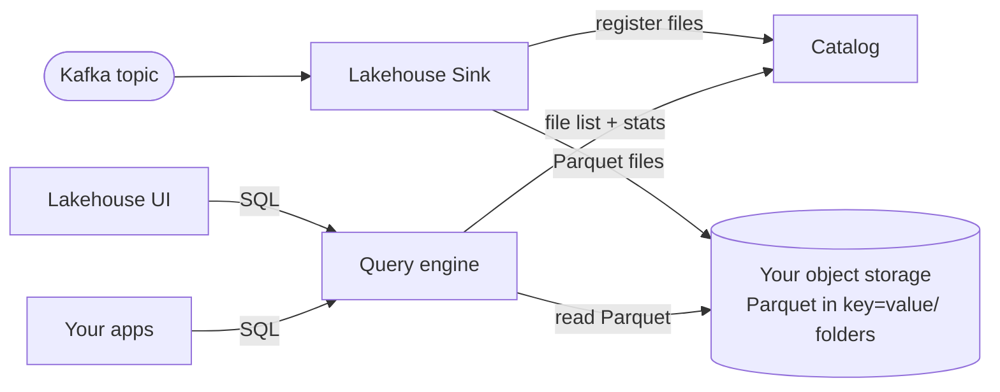

# Lakehouse overview

**Lakehouse** is the **query-first** option in [Quix Lake](../overview.md). It persists Kafka topic data as **Parquet tables in Hive-style `key=value/` folders** on your object storage, with a Quix-managed catalog and a SQL query engine — so you can run **interactive SQL** and **time-series analytics** without standing up a separate warehouse.

If you need byte-for-byte replay fidelity rather than query access, see **[Data Lake](../data-lake/overview.md)**. Not sure which to pick? Read [Choosing between them](../overview.md#choosing-between-them) in the Quix Lake overview.

## What you get

* **SQL access** — query historical topic data with standard SQL; no warehouse to manage
* **Open Parquet files** — plain Parquet files in Hive-style `key=value/` folders on your bucket. Spark, Trino, DuckDB, and other engines can read them directly as a Hive-partitioned layout. The Lakehouse does not use Apache Iceberg, so these engines cannot read a table as an Iceberg table
* **Time-series friendly** — partition folders + columnar Parquet + per-file min/max statistics means range scans and aggregates prune aggressively
* **Catalog-backed** — schemas, partitions, files, and statistics tracked by a Quix-managed catalog so the Query engine and UI never have to scan storage
* **Yours** — Parquet lives in your object storage; only catalog metadata lives in Quix-managed services

!!! info "Prerequisites"
    A [Quix Lake connection](../blob-storage.md) must be configured for the cluster. The same connection can be shared with the [Data Lake Sink](../data-lake/sink.md) if you want both.

## Components

Quix runs one Lakehouse for each storage that you deploy it on. Environments whose main storage is that storage share it. Once it's set up, you interact with two surfaces:

| Surface | What it does |
|---|---|
| **[Lakehouse Sink](./sink.md)** | Connector you deploy per Kafka topic. Writes Parquet files to your bucket and registers them with the catalog. |
| **[UI](./ui.md)** | The **Query Data** page in the portal. Browse tables, inspect schemas, run SQL, and ask the AI chat. |

Behind the scenes, the Lakehouse runs a small set of managed services — see **[Catalog](./catalog.md)**, **[Query](./query.md)**, and **[Database](./database.md)** if you want to understand how it fits together. You don't configure these directly. An organization admin deploys them one time, and Quix operates them.

## Deploy the Lakehouse

An organization admin deploys the Lakehouse services:

1. Open **Settings → Quix Lake** and select the connection.
2. Open the **Services** tab.
3. Click **Deploy services**. This deploys all Quix Lake services that are missing, the Lakehouse services included.

If some Quix Lake services are already deployed, the tab shows a **Missing Quix Lake services** banner instead. Click **Deploy** on the banner to deploy the rest. Other users see the message "An organization admin deploys them from this tab."

## How it works

1. **Ingest** — the [Lakehouse Sink](./sink.md) consumes from Kafka and writes Parquet files into the table folder on your bucket.
2. **Register** — the sink adds the new files to the [Catalog](./catalog.md), with their partition values and min/max statistics.
3. **Query** — the [Query](./query.md) engine reads the file list from the Catalog, prunes files by partition + column statistics, and reads only the relevant Parquet.
4. **Compact** — the Query service merges small files into larger files. See [Compaction](#compaction).
5. **Explore** — use the [UI](./ui.md) to browse tables and run queries in the portal, or call the Query service directly from your own apps.

## Sharing across environments

* Quix runs one Lakehouse **for each storage** that you deploy it on. Environments whose main storage is that storage share the Lakehouse and its tables.
* You deploy sinks **per environment**. Each sink binds automatically to the Lakehouse on the main storage of its environment.
* After a [main storage move](../blob-storage.md#make-a-storage-the-main-storage), the Lakehouse stays on its storage. Deployments and sinks then get the Lakehouse variables only from a Lakehouse on the new main storage.

## Operational behavior

* **Concurrent writers** — multiple sink replicas, and sinks from different environments that share the storage, each write their own files and register them in the Catalog.
* **Reads** — each query plans against the file list that the Catalog holds when the query starts. The Lakehouse keeps no version history of a table.
* **Schema changes** — each Parquet file keeps its own schema. See [Schema changes](./query.md#schema-changes).

### Compaction

A sink writes many small files. Compaction merges them into larger files, so queries read fewer files.

* **Manual** — in the [UI](./ui.md), open the menu of a table and click **Compact**. You can also call `POST /compact` on the [Query](./query.md) service.
* **Scheduled** — the Query service runs a compaction scheduler by default (`CONTINUOUS_COMPACTION=true`). The scheduler compacts only the tables that have a compaction schedule. To set one, open the menu of a table in the UI and click **Compaction schedule**. By default, a schedule runs at most every 60 minutes and targets files of 128 MB.

## Security

* Sinks and the Query engine authenticate against the Catalog with a Quix-managed bearer token. You don't configure auth tokens manually.
* Your data lives in your bucket; Quix never copies the Parquet anywhere outside it.
* The Query service limits every query to files in your own environments, plus public folders and environments where you have an organization-level write grant. It asks the portal which environments your token can access. If the portal does not answer, the query gets no files from your environments.
* Writes (insert, delete, compact, repartition, upload) work only on tables in your own environments. A public folder is read-only.

## See also

* [Lakehouse Sink](./sink.md) — persist a topic as a Parquet table
* [UI](./ui.md) — browse and query in the portal
* [Query](./query.md) — SQL surface for your apps
* [Catalog](./catalog.md) — how table metadata is tracked
* [Database](./database.md) — backing storage for the Catalog
* [Quix Lake connections and storages](../blob-storage.md)
* [Data Lake overview](../data-lake/overview.md) — replay-first alternative
